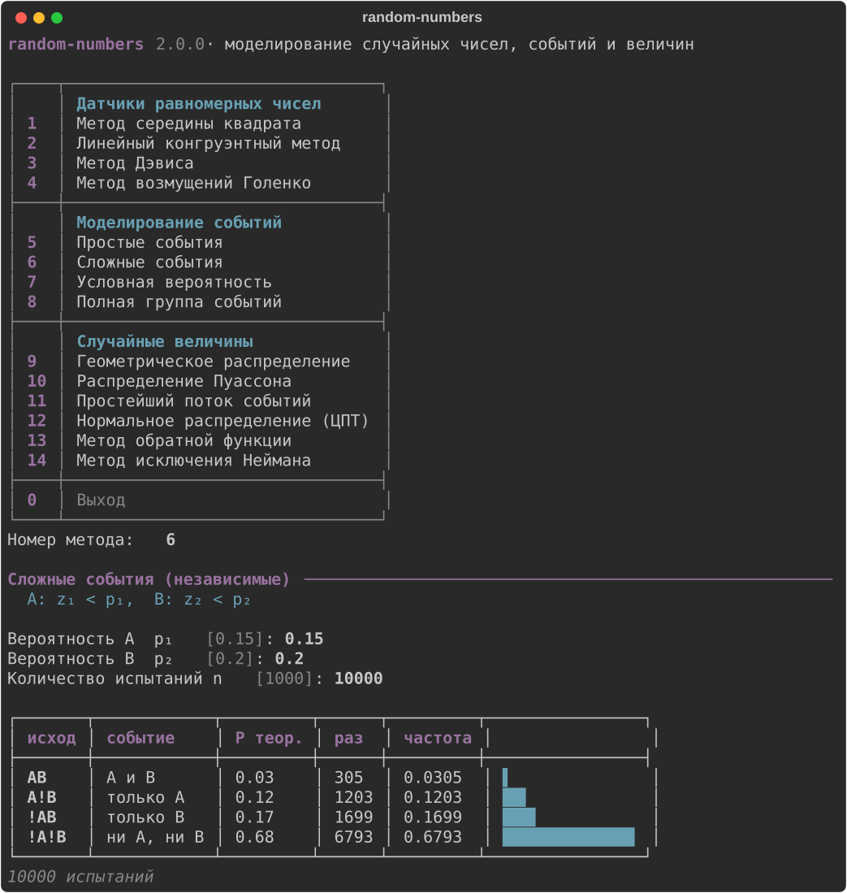
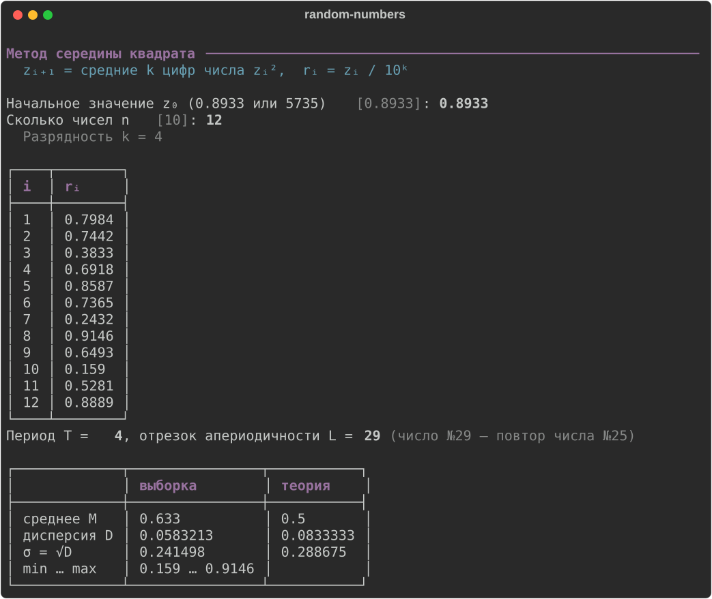
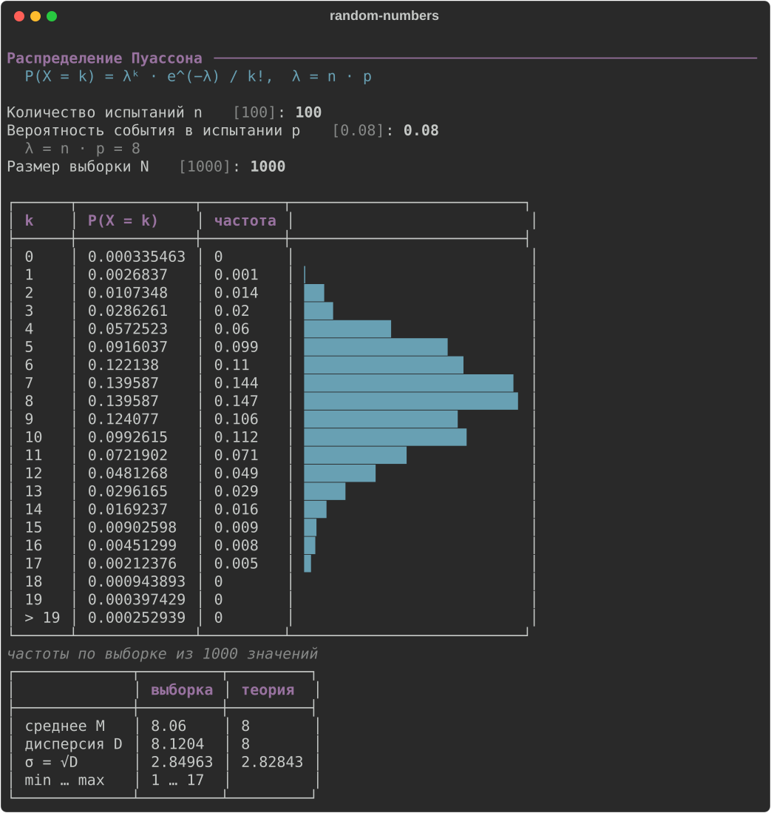
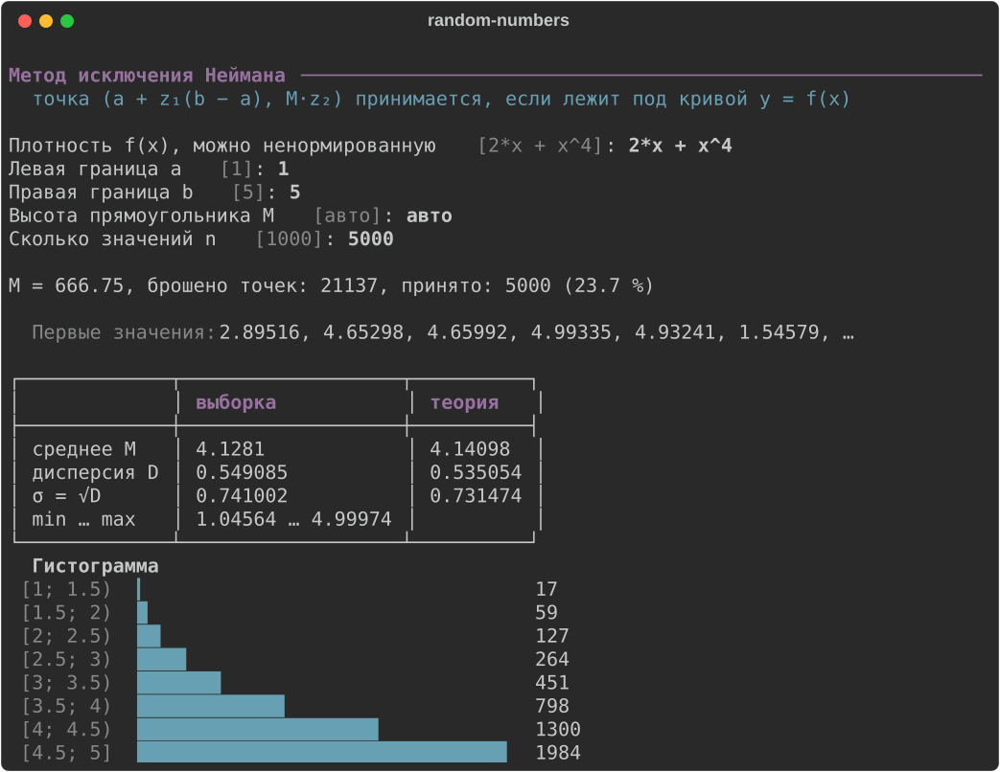

<div align="center">

# 🎲 random-numbers

**Pseudo-random number generators, simulation of random events and random variables.**

A Python library and an interactive console program built from a university
course on computer simulation: classic generators of uniform numbers, Monte
Carlo simulation of events, and the methods that turn uniform numbers into
any distribution. Every result comes with the theory next to it: periods,
probabilities, means, variances and histograms.

[](https://github.com/mredwardlik/random-numbers/actions/workflows/tests.yml)




</div>

---

## ✨ Features

- 🔢 **Four generators of uniform numbers**: middle-square, linear congruential,
  Davis additive and Golenko perturbation methods. The exact period and the
  aperiodic segment of every sequence are found with Brent's algorithm
- 🎯 **Simulation of events**: simple, independent, dependent (conditional
  probability) and a complete group of events. Observed frequencies are shown
  next to the theoretical probabilities
- 📊 **Random variables**: geometric and Poisson distributions, the Poisson
  process, the normal distribution by the central limit theorem, the inverse
  transform method and the Neumann rejection method
- ✍️ **Your own formulas**: type a density `2*x + x^4` or an inverse function
  `-ln(1 - z) / 2` right in the menu. Formulas are parsed safely, without `eval`
- 📈 **Readable output**: tables, frequency bars and histograms in the terminal,
  sample mean and variance against the theory
- 🔁 **Reproducible**: `--seed` gives the same results on every run
- 🛡 **Careful input**: defaults on Enter, `0,14` as well as `0.14`, fractions
  like `8/24`, clear messages and a second try on a wrong value

## 🧮 Methods

The interface of the program is in Russian, as in the course.

| #  | Method                                           | Formula                                                        |
| -: | ------------------------------------------------ | -------------------------------------------------------------- |
|  1 | Middle-square (метод середины квадрата)          | `z[i+1]` = middle `k` digits of `z[i]²`                        |
|  2 | Linear congruential (линейный конгруэнтный)      | `z[i+1] = (a·z[i] + c) mod m`, `r = z / m`                     |
|  3 | Davis additive (метод Дэвиса)                    | `z[i] = (z[i-1] + z[i-k]) mod m`                               |
|  4 | Golenko perturbation (метод возмущений Голенко)  | LCG, every `p`-th number is the middle-square of the previous  |
|  5 | Simple events                                    | `A` happens when `z < p`                                       |
|  6 | Independent events                               | `AB`, `A!B`, `!AB`, `!A!B` with `P(A) = p₁`, `P(B) = p₂`       |
|  7 | Conditional probability                          | `P(A)`, `P(B\|A)`, `P(B\|!A)` and the total probability of `B` |
|  8 | Complete group of events                         | event `i` when `z` falls into the `i`-th segment of length `pᵢ` |
|  9 | Geometric distribution                           | `P(X = k) = (1 − p)^(k−1)·p`, `X = ⌊ln z / ln(1 − p)⌋ + 1`     |
| 10 | Poisson distribution                             | `P(X = k) = λ^k·e^(−λ) / k!`, `λ = n·p`                        |
| 11 | Poisson process (простейший поток)               | `t[i] = t[i-1] − ln z / λ`                                     |
| 12 | Normal distribution, central limit theorem       | `x = m + σ·(z₁ + … + z₁₂ − 6)`                                 |
| 13 | Inverse transform                                | `x = F⁻¹(z)` for any formula                                   |
| 14 | Neumann rejection                                | keep `(a + z₁(b − a), M·z₂)` under the curve `y = f(x)`        |

## 🚀 Installation

```bash
pip install git+https://github.com/mredwardlik/random-numbers.git
```

Python 3.10 or newer. This installs the `random-numbers` command and the
`random_numbers` Python package. The only dependency is
[rich](https://github.com/Textualize/rich).

## 💻 Interactive menu

```bash
random-numbers             # open the menu
random-numbers --seed 42   # the same random results on every run
python -m random_numbers   # the same without the command
python main.py             # from a clone, without installing
```

Choose a method by its number. Every parameter has a default in brackets:
press Enter to take it. `0` or `Ctrl+C` in the menu exits.

<details>
<summary><b>Generators</b>: the sequence, its period, mean and variance</summary>
<br>

</details>

<details>
<summary><b>Poisson distribution</b>: theoretical probabilities against a sample</summary>
<br>

</details>

<details>
<summary><b>Neumann method</b>: a density typed as a formula, the histogram of the result</summary>
<br>

</details>

| Input           | Accepted                                                                         |
| --------------- | -------------------------------------------------------------------------------- |
| numbers         | `0.14`, `0,14`, `1e-6`, fractions `8/24`                                         |
| lists           | `0.1 0.2 0.3 0.4`, `0.1, 0.2, 0.3`, `40;60;30`                                   |
| group of events | probabilities that sum to 1, or any frequencies (`40 60 30 20`), they are normalized |
| formulas        | `+ - * / ^ %`, `pi`, `e`, `sqrt exp ln log log10 sin cos tan asin acos atan abs min max …` |

## 🐍 Python API

```python
import math
import random

from random_numbers import (Function, LinearCongruential, MiddleSquare, complex_events,
                            inverse_transform, neumann, poisson_process)

# generators are iterators of numbers in [0, 1)
MiddleSquare('0.8933').take(3)                    # [0.7984, 0.7442, 0.3833]
lcg = LinearCongruential(7, a=21, c=17, m=100)
lcg.take(3)                                       # [0.64, 0.61, 0.98]
lcg.period()                                      # Period(start=0, length=100)

# events: counts next to the theoretical probabilities
rng = random.Random(42)                           # optional, for reproducible results
result = complex_events(0.15, 0.2, 10_000, rng)
result.counts                                     # {'AB': 294, 'A!B': 1229, '!AB': 1742, '!A!B': 6735}
result.probabilities['AB']                        # 0.03
result.frequency('AB')                            # 0.0294

# random variables
poisson_process(5, 10, rng)                       # times of about 50 events on (0, 10]
inverse_transform(lambda z: -math.log(1 - z) / 2, 1000, rng)        # exponential, λ = 2
neumann(Function('2*x + x^4'), 1, 5, 1000, rng).x                   # density ∝ 2x + x⁴ on [1, 5]
```

Every function checks its arguments and raises `ValueError` with a message in
Russian, the same one the menu shows.

| Module                          | Contents                                                                                     |
| ------------------------------- | -------------------------------------------------------------------------------------------- |
| `random_numbers.generators`     | `MiddleSquare`, `LinearCongruential`, `Davis`, `Golenko`, `Period`                             |
| `random_numbers.events`         | `simple_events`, `complex_events`, `conditional_events`, `group_events`, `to_probabilities`    |
| `random_numbers.distributions`  | `geometric_*`, `poisson_*`, `poisson_process`, `normal_clt`, `inverse_transform`, `neumann`    |
| `random_numbers.expression`     | `Function`: a safe formula of one variable                                                   |
| `random_numbers.stats`          | `describe`, `histogram`                                                                      |

## 🎓 Lab examples

The `examples/` folder has the original lab problems (in Russian), solved with
the package:

| File                     | Problem                                                                       |
| ------------------------ | ----------------------------------------------------------------------------- |
| `examples/example_1.py`  | cars at a car wash: a complete group of events from observed frequencies     |
| `examples/example_2.py`  | losses from late deliveries: simple events                                    |
| `examples/example_3.py`  | intervals between customers: the inverse transform method                    |
| `examples/example_4.py`  | the Neumann method for `f(x) = 2x + x⁴`, with a plot if matplotlib is installed |

```bash
python examples/example_1.py
pip install "random-numbers[plot] @ git+https://github.com/mredwardlik/random-numbers.git"  # for the plot
```

## 🪟 Windows .exe

`build.bat` creates a virtual environment, installs the package with
PyInstaller and builds a single `dist\random-numbers.exe` with the icon. The
.exe runs without Python.

## 🗂 Project structure

```text
random-numbers/
├── random_numbers/
│   ├── generators.py     # MiddleSquare, LinearCongruential, Davis, Golenko, periods
│   ├── events.py         # simple, independent, dependent events, complete group
│   ├── distributions.py  # geometric, Poisson, Poisson process, normal, inverse, Neumann
│   ├── expression.py     # safe parser of formulas typed by the user
│   ├── stats.py          # mean, variance, histograms
│   ├── ui.py             # console input with checks, tables and bars
│   ├── menu.py           # the 14 methods of the menu
│   └── cli.py            # the random-numbers command
├── examples/             # lab problems
├── tests/                # pytest
├── main.py               # entry point for python main.py and the .exe
└── build.bat             # builds random-numbers.exe
```

## 🧪 Tests

```bash
pip install -e ".[dev]"
pytest
```

Tests check the generators against values worked out by hand, the periods
(including the full period of an LCG by the Hull–Dobell theorem), that sampled
frequencies, means and variances match the theory, the formula parser against
unsafe input, and every menu item from start to end. Doctests in the modules
run too.
